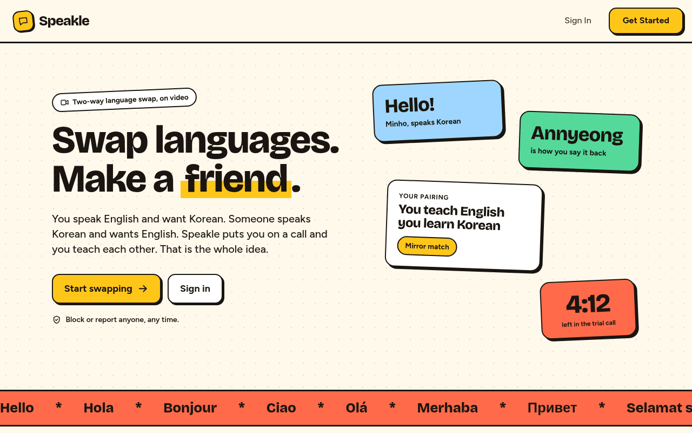
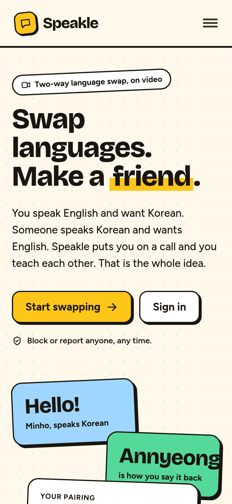
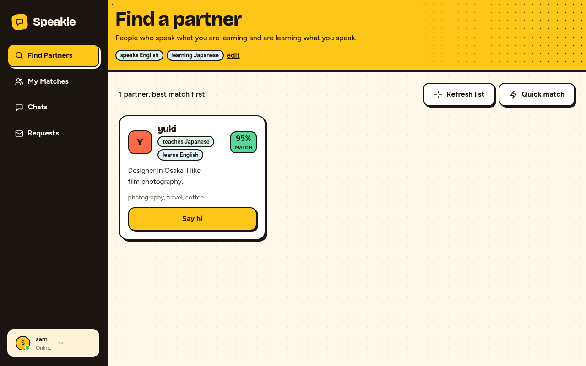
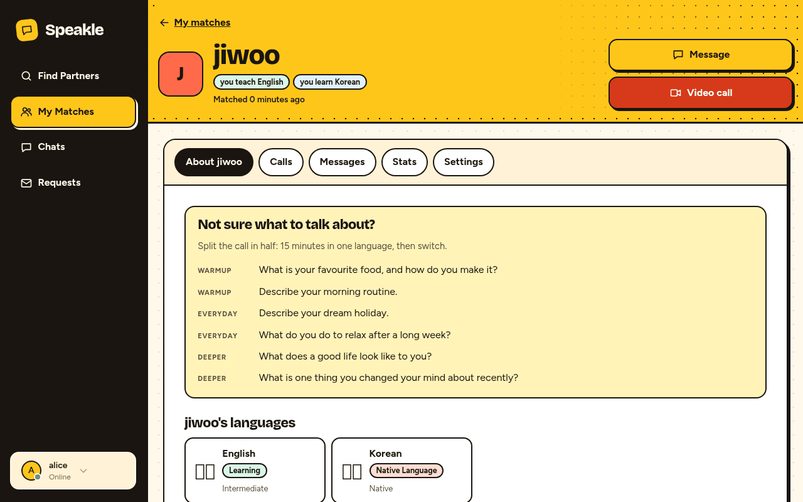
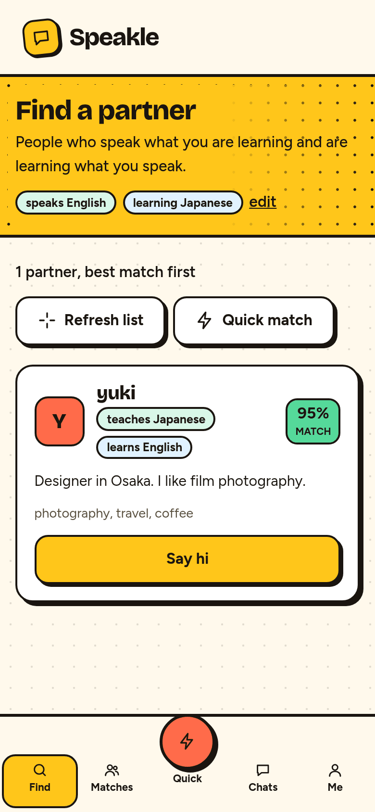
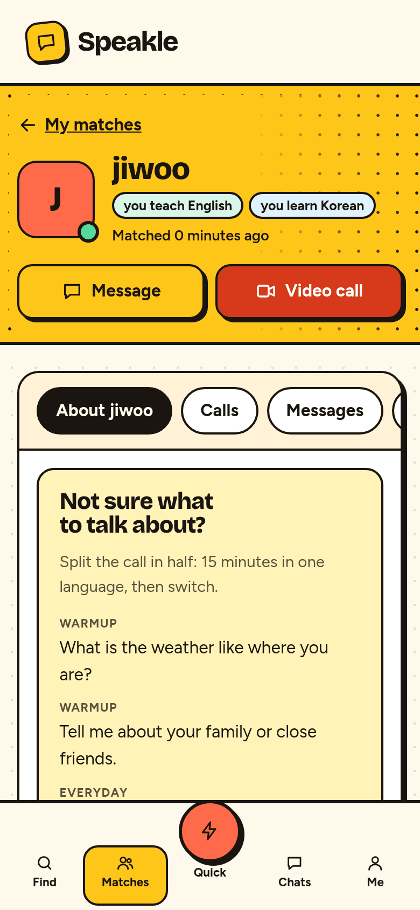

# Speakle

Free two-way language exchange in the browser. You speak English and want Korean, someone speaks Korean and wants English, and Speakle puts you on a call to teach each other.

Live: https://speakle.javohirmx.com/

<p>
  
  
</p>

## Contents

- [Features](#features)
- [Screenshots](#screenshots)
- [How matching works](#how-matching-works)
- [Quickstart](#quickstart)
- [Configuration](#configuration)
- [Tests](#tests)
- [Front-end CSS](#front-end-css)
- [Deploy](#deploy)
- [Project layout](#project-layout)
- [Known limits](#known-limits)
- [Contributing](#contributing)
- [License](#license)

## Features

- **Accounts.** Sign-up with username, email and password, email verification, password reset by email, and a profile with bio, interests and picture. Failed sign-ins are throttled.
- **Languages.** Each person lists languages they speak (native or fluent) and languages they are learning, with a proficiency level.
- **Partner suggestions.** Partners who speak what you are learning and are learning what you speak, best match first. Send, accept, decline and cancel match requests.
- **Quick match.** Join a waiting pool and get paired live with another member for a 5 minute trial call. Afterwards both people choose keep or skip. Requires a verified email by default.
- **Video calls and chat.** Peer-to-peer WebRTC video with screen sharing, plus text chat with typing indicators and message editing. Presence and incoming-call notifications run over WebSockets (Django Channels).
- **Conversation prompts and feedback.** Starter questions on each match page, and private feedback after a call.
- **Call history.** Past calls and per-call summaries.
- **Safety.** Block and report other users. Reports go to an admin review screen. Blocked people never show up in matching.
- **Privacy-first analytics.** Per-day counters per page name, plus referrer host and `?utm_source=` on the landing, sign-in and sign-up pages. No IP address, cookie, user agent, user id or chat content is stored, and nothing is sent to a third party. `ANALYTICS_ENABLED = False` turns it off. A staff-only `/stats/` page shows aggregate counts.
- **Basics.** Canonical URLs, Open Graph and Twitter cards, JSON-LD, `robots.txt`, `sitemap.xml`, web manifest, custom 404 and 500 pages, UI checked with axe-core in a real browser.

## Screenshots

Taken in a real browser against a local database with demo accounts. The names and profiles are made up for the screenshots.

| Find a partner | Match page |
|---|---|
|  |  |

| Find a partner (390px) | Match page (390px) |
|---|---|
|  |  |

## How matching works

Matching is rule-based, not machine learning (`matches/services.py`). A pair needs a mirror: you can teach what they are learning and they can teach what you are learning. The score is out of 100:

- 50 for a valid language pairing.
- Up to 30 for proficiency fit (a native or advanced teacher with a beginner or intermediate learner scores highest).
- 5 per shared interest word, up to 6 words.
- 10 if both people wrote a bio longer than 50 characters.

## Quickstart

Python 3.11 is what CI and the Docker image use.

```bash
git clone https://github.com/JavohirMX/speakle.git
cd speakle
python -m venv .venv && source .venv/bin/activate
pip install -r requirements.txt
export DEBUG=True                       # local development only, see below
python manage.py migrate
python manage.py populate_languages     # the language list is not created by migrations
python manage.py createsuperuser        # optional, for /admin/
daphne -b 127.0.0.1 -p 8000 config.asgi:application
```

Open http://127.0.0.1:8000/.

- **Safe by default.** Debug is off and the app refuses to start without a real `SECRET_KEY`. `DEBUG=True` (environment variable or a `.env` file) enables a throwaway key for local use. The test runner needs nothing.
- **Use Daphne** for calls, chat and notifications, because they need WebSockets. `python manage.py runserver` is fine for pages that do not.
- **Email** prints to the console in development, so verification and password-reset links appear in the server log.
- **Database** is SQLite (`db.sqlite3`) unless you use the production settings.
- Two or more accounts are needed to try matching. Register them with complementary languages, for example one who speaks English and learns Korean and one who speaks Korean and learns English. You can open the second in a private window.
- Video calls need camera and microphone access, and a secure context (`localhost` counts).

## Configuration

Local development works without any config beyond `DEBUG=True`. Docker and production read environment variables (or a `.env` file, via python-decouple). Copy `env.example` to `.env` and edit it.

| Variable | Purpose |
|---|---|
| `DJANGO_SETTINGS_MODULE` | `config.settings_prod` for Docker and production. Without it you get the development settings (in-memory channel layer, console email, SQLite, no HTTPS or HSTS settings). `env.example` sets it. |
| `SECRET_KEY` | Required. Long random value. The app will not start with a placeholder. |
| `DEBUG` | `False` in production. Defaults to `False`. |
| `ALLOWED_HOSTS`, `CSRF_TRUSTED_ORIGINS` | Your domain(s), comma separated. `CSRF_TRUSTED_ORIGINS` needs the scheme, for example `https://speakle.example.com`. |
| `SITE_URL` | Public origin, for example `https://speakle.example.com`. Used for canonical URLs, the sitemap, share images and email links. |
| `DATABASE_URL` | Postgres URL. Falls back to SQLite if unset. |
| `REDIS_URL` | Redis for the Channels layer, cache and sessions. |
| `EMAIL_BACKEND`, `EMAIL_HOST`, `EMAIL_PORT`, `EMAIL_USE_TLS`, `EMAIL_HOST_USER`, `EMAIL_HOST_PASSWORD`, `DEFAULT_FROM_EMAIL` | SMTP for verification and password reset. Without them, links only print to the container log. |
| `WEBRTC_STUN_URLS` | Comma-separated STUN URLs for video calls. Defaults to five public Google STUN servers. Empty means none. |
| `WEBRTC_TURN_URLS`, `WEBRTC_TURN_USERNAME`, `WEBRTC_TURN_CREDENTIAL` | Optional TURN relay for networks where direct calls fail. A TURN entry is used only when all three are set. |
| `QUICK_MATCH_REQUIRE_VERIFIED_EMAIL` | Require a verified email for quick match. Default `True`. |
| `SIGNUPS_PER_HOUR_PER_IP` | Cap sign-ups per client address per hour. `0` (default) is off. Leave it off behind a proxy that hides client addresses. |
| `SECURE_SSL_REDIRECT`, `SECURE_HSTS_*`, `CSRF_COOKIE_SECURE`, `SESSION_COOKIE_SECURE`, `X_FRAME_OPTIONS` | HTTPS hardening. Cookie and redirect flags default to off, so turn them on once HTTPS works. HSTS defaults to one year, so only deploy with HTTPS. |
| `TIME_ZONE`, `LANGUAGE_CODE` | Default `Asia/Seoul` and `en-us`. |
| `POSTGRES_DB`, `POSTGRES_USER`, `POSTGRES_PASSWORD` | Read by the Postgres container in `docker-compose.yml`. |
| `DJANGO_SUPERUSER_USERNAME`, `DJANGO_SUPERUSER_EMAIL`, `DJANGO_SUPERUSER_PASSWORD` | The Docker entrypoint creates this admin only if the password is set. |

`MEDIA_URL` and `STATIC_URL` appear in `env.example` but are fixed in code (`/media/`, `/static/`).

## Tests

```bash
python manage.py test
```

About 250 tests covering accounts, matching, quick match, chat, WebSocket consumers, SEO, analytics and settings safety. They take a few minutes. CI runs the same tests plus `manage.py check` and `makemigrations --check` on every pull request (`.github/workflows/ci.yml`).

Not covered by automated tests: real camera and microphone calls between devices, and the Postgres and Redis stack.

## Front-end CSS

- `static/css/tailwind.css` is compiled ahead of time (Tailwind 3). After adding utility classes to a template, rebuild:

  ```bash
  npm i -D tailwindcss@3
  npx tailwindcss -c tailwind.config.js -i static/css/tailwind.src.css -o static/css/tailwind.css --minify
  ```

  The first command creates `package.json` and `node_modules/` locally. Do not commit them.
- `static/css/app.css` (layout and components) and `static/css/design.css` (design tokens and shared components) are plain hand-written CSS. Templates link them with a content hash (``), so they can be cached for a long time and a change gets a new URL.
- Fonts are self-hosted in `static/fonts/`.

## Deploy

Full guide: [DEPLOYMENT.md](DEPLOYMENT.md). Short version:

```bash
cp env.example .env     # set SECRET_KEY, ALLOWED_HOSTS, CSRF_TRUSTED_ORIGINS, SITE_URL, passwords
docker compose up -d --build
docker compose exec web python manage.py populate_languages
```

The stack is Daphne (port 8001 on the host), Postgres and Redis. The entrypoint runs migrations and `collectstatic`. Serve `/static/` and `/media/` from a reverse proxy, which is not included in this repository. Pushes to `main` run `.github/workflows/deploy.yml`.

## Project layout

```
config/       settings.py (development), settings_prod.py (Docker and production), urls, asgi
users/        accounts, languages, email verification, block and report, throttling
matches/      partner suggestions, requests, matches, quick match, feedback
chats/        video rooms, call invitations, sessions, text chat, presence, WebSocket consumers
main/         landing page, SEO endpoints, analytics, staff stats page, error pages
static/       compiled Tailwind, app and design CSS, fonts, images
docs/         architecture notes, older docs, screenshots
```

See [docs/ARCHITECTURE.md](docs/ARCHITECTURE.md) for models, WebSocket endpoints and call flow.

## Known limits

- Calls use public Google STUN servers by default, with no TURN relay. Some networks (strict NATs, some mobile carriers) will not connect. Set the `WEBRTC_TURN_*` variables to add a TURN relay.
- Session reminders need a scheduler: `python manage.py send_session_reminders` sends the 24h and 1h emails once each. Run it from cron (every 5 minutes is fine); it is not wired into Docker by default.

## Contributing

Read [CONTRIBUTING.md](CONTRIBUTING.md) and [CHANGELOG.md](CHANGELOG.md). Branch from `dev` and open pull requests against `dev`.

## License

There is no license file in this repository yet, so by default all rights are reserved. An older README said MIT. Add a `LICENSE` file if that is the intent.
